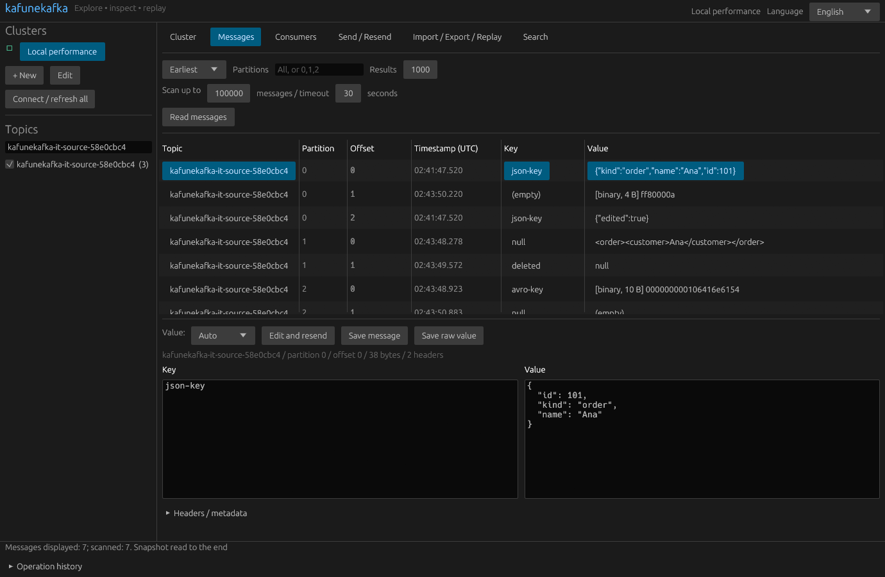

# kafunekafka

## Stop waiting for better software. Build it.

We're tired of desktop apps that need gigabytes of RAM just to display a few tables.

So we built our own.

**Open Source. AI-Built. Rust-Powered.**

Less bloat. More performance. No excuses.

**The revolution will be compiled.**

---

**A fast, native Kafka desktop client for Windows and Linux.**

Browse clusters, inspect messages, find what matters, and replay events — from one desktop app built in Rust.

[**Download for Windows x64**](https://github.com/rgt001/kafune-kafka/releases/download/v0.4.0/kafunekafka-v0.4.0-windows-x64.zip) · [Linux x64](https://github.com/rgt001/kafune-kafka/releases/download/v0.4.0/kafunekafka-v0.4.0-linux-x64.tar.gz) · [All releases](https://github.com/rgt001/kafune-kafka/releases) · [Português](README.pt-BR.md) · [Русский](README.ru.md)



## Download and run

1. Download `kafunekafka-v0.4.0-windows-x64.zip` from [Releases](https://github.com/rgt001/kafune-kafka/releases/latest).
2. Extract the **entire ZIP** to a folder.
3. Run **`kafunekafka.exe`**, keeping its DLLs alongside it.
4. Add your Kafka bootstrap servers and connect.

No Rust toolchain, Java, Offset Explorer, or Docker installation is required to run the Windows app. Docker is only used for local development and integration tests. You need network access to your Kafka cluster.

Every release includes a SHA-256 checksum, the application licence, and third-party licence notices. To check the ZIP on Windows:

```powershell
Get-FileHash .\kafunekafka-v0.4.0-windows-x64.zip -Algorithm SHA256
```

Compare the result with the matching `.sha256` asset. Cluster profiles and credentials are not included in the download.

The Linux archive contains a native x64 executable built on Ubuntu 22.04 (glibc 2.35). Extract it and run `./kafunekafka/kafunekafka` from an X11/Wayland desktop with OpenGL available. It has been tested on Ubuntu 22.04 through WSL; other distributions have not been exercised.

## What it does

| Feature | Where |
|---|---|
| Multiple clusters, brokers, topics, partitions and consumer groups | Sidebar and Cluster |
| Read messages and inspect keys, values, timestamps and headers | Messages |
| Consumer committed offsets and lag | Consumers |
| Pretty JSON, XML, Confluent Avro and Avro container files | Message format selector |
| Save individual messages or raw values | Messages |
| Import and export local message archives | Import / Export / Replay |
| Replay to another topic or cluster | Import / Export / Replay |
| Send a new message directly to a topic | Send / Resend |
| Edit an existing message before resending it | Messages → Edit and resend |
| Search topics and partitions with text or regex | Search |
| Native desktop builds | Windows and Linux |

The interface supports **English, Português and Русский**. Choose a language in the top-right menu; it changes immediately and is remembered after restarting. Portuguese remains the default. Labels, forms, application errors, validation and progress messages are translated. Kafka payloads and user-entered names are preserved.

The preference is stored in `settings.json`, beside the cluster-profile file. For a temporary override, set `KAFUNEKAFKA_LANGUAGE=en`, `ru` or `pt-BR`. Native file-dialog buttons follow the operating system; operation history keeps the language used when each entry was recorded. See [translation maintenance](locales/README.md).

Connection settings support PLAINTEXT, TLS, SASL/PLAIN and SCRAM, plus Schema Registry settings and local Avro schemas. Local validation has exercised PLAINTEXT and SASL/PLAIN; TLS/SCRAM and production clusters have not been exercised.

## Message handling

- Inspection uses explicit partition assignment, `read_committed`, and disabled auto-commit. It does not advance existing consumer-group offsets.
- A read captures each partition's upper offset when it starts. Incoming traffic does not extend the snapshot indefinitely.
- JSONL archives use `kafunekafka.record.v1`, preserving binary keys and values, nulls, empty bytes, repeated headers and timestamps.
- Imports validate the archive and destination partitions before publishing. Replays preserve message bytes instead of converting the payload format.
- Publishing waits for broker acknowledgements. Cancelling a transfer stops new submissions and drains pending deliveries.
- Repeating an import or replay can publish the same messages again. Producer idempotence applies within a producer session.
- The table retains at most 20,000 results and 128 MiB per read/search. Export streams larger selections to disk.

Destination topics must already exist. Topic creation/deletion and consumer-offset resets are not exposed in this release.

## Build from source

The dependency versions are locked in `Cargo.lock`.

### Windows

Install Rust stable, Visual Studio C++ Build Tools, CMake, Strawberry Perl and NASM:

```powershell
.\scripts\build-windows.ps1 -Command build -Release
.\target\release\kafunekafka.exe
```

### Linux

On Ubuntu/Debian:

```bash
sudo apt-get install build-essential pkg-config cmake libssl-dev \
  libxcb-render0-dev libxcb-shape0-dev libxcb-xfixes0-dev \
  libxkbcommon-dev libxkbcommon-x11-dev libgtk-3-dev
cargo build --release --locked --bin kafunekafka
./target/release/kafunekafka
```

The desktop renderer uses OpenGL with X11 or Wayland.

## Test

Unit tests do not require a running broker:

```bash
cargo test --locked --lib
cargo clippy --locked --all-targets -- -D warnings
```

For real Kafka tests, `compose.yaml` starts two local clusters and a Schema Registry. Its ports are bound to loopback, and its SASL password is deliberately a public development fixture:

```bash
docker compose up -d
cargo test --locked --test kafka_end_to_end --test bulk_transfer --test read_session -- --ignored --nocapture
```

The tests exercise the twelve original requirements, binary/null/header preservation, Schema Registry references, consumer offsets, cross-cluster replay, edited resend, cancellation and reused-reader recovery. They leave uniquely named fixture topics available for inspection.

Native GUI smoke test:

```bash
./target/debug/kafunekafka --smoke-ui artifacts/ui-linux.png
```

Use `KAFUNEKAFKA_CONFIG` to select an isolated profile JSON file. `KAFUNEKAFKA_TRACE=1` enables phase timings without logging credentials or payloads.

## Performance

A permanent worker, reused readers, virtualized lists and bounded transfer queues keep work off the UI thread. Reads fetch fresh metadata and watermarks and remove their assignment when they finish or are cancelled.

Historical Windows GUI measurements from 2026-10-14, before the branding change, reduced the median for 12,000 messages from **185.7 ms to 62.8 ms** across 45 reads per version. These are local results, not a guarantee for every cluster. See [Windows GUI measurements](PERFORMANCE-WINDOWS-GUI.md) and [CLI measurements](PERFORMANCE.md) for methods and limits; the CLI numbers include process startup and are not GUI latency measurements.

## Release packaging

```powershell
cargo build --release --locked --bin kafunekafka
python scripts/package_windows.py --tag v0.4.0
```

This creates a portable ZIP and checksum in `dist/`, including the x64 MSVC runtime and dependency licences. The packaging script verifies every archived file.

For a Linux executable built on Linux, `python scripts/package_linux.py --tag v0.4.0` creates the corresponding archive and checksum.

The [Windows release workflow](.github/workflows/windows-release.yml) checks formatting, clippy and unit tests, builds the executable and publishes tagged releases. Manual runs produce downloadable workflow artifacts. Real Kafka integration tests run separately against the local development stack.

## Contributing and licence

Issues and pull requests are welcome. For behavior changes, include focused validation; broker-dependent tests require the development stack above. Keep cluster profiles, passwords, private keys, build outputs and local benchmark data out of commits.

**Open source under the [MIT licence](LICENSE).** Third-party dependencies retain their own licences and are listed in release packages.
