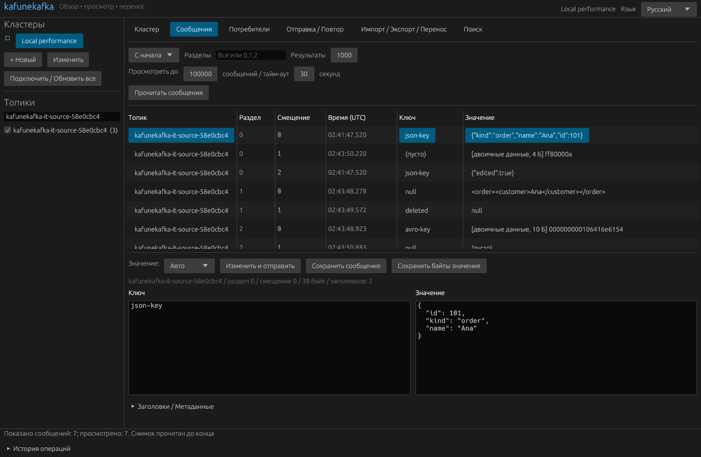

# kafunekafka

**Open Source. AI-Built. Rust-Powered.**

Нативное настольное приложение для Kafka на Rust: Windows и Linux.

[Скачать для Windows x64](https://github.com/rgt001/kafune-kafka/releases/download/v0.4.0/kafunekafka-v0.4.0-windows-x64.zip) · [Linux x64](https://github.com/rgt001/kafune-kafka/releases/download/v0.4.0/kafunekafka-v0.4.0-linux-x64.tar.gz) · [English](README.md) · [Português](README.pt-BR.md)

## Начало работы

1. Скачайте и полностью распакуйте ZIP для Windows.
2. Запустите `kafunekafka.exe`, оставив DLL в той же папке. Rust, Java и Docker для запуска не нужны.
3. В меню языка справа вверху выберите **Русский**. Язык сохраняется после перезапуска; также доступны English и Português.
4. Добавьте начальные адреса брокеров Kafka и подключитесь. Выберите топики на боковой панели.

Пакет Linux собран и проверен на Ubuntu 22.04 в WSL (glibc 2.35). Распакуйте архив и запустите `./kafunekafka/kafunekafka` в графическом сеансе X11/Wayland с OpenGL. Другие дистрибутивы не проверялись.

## Возможности

- Просмотр кластеров, брокеров, топиков, разделов и групп потребителей.
- Чтение сообщений, просмотр ключей, значений, заголовков, времени и смещений потребителей.
- Форматирование JSON, XML и Avro, в том числе через Schema Registry.
- Сохранение отдельных сообщений, импорт и экспорт архивов JSONL.
- Повторная отправка в другой топик или кластер с сохранением двоичных данных.
- Отправка новых сообщений и редактирование перед повторной отправкой.
- Поиск по нескольким топикам и разделам, включая регулярные выражения.

Просмотр не изменяет сохранённые смещения групп потребителей. Целевой топик должен существовать. Повторный запуск импорта или replay может создать дубликаты сообщений.

## Язык и настройки

Интерфейс, формы, сообщения приложения об ошибках и ходе операций переведены. Данные Kafka и введённые пользователем имена не переводятся. Язык хранится в `settings.json`, отдельно от соединений. Временный выбор возможен через `KAFUNEKAFKA_LANGUAGE=ru`, `en` или `pt-BR`.

История сохраняет язык, использованный при выполнении операции. Кнопки системных диалогов следуют языку операционной системы. Пароли, введённые в приложении, хранятся только в текущем сеансе.

## Исходный код и лицензия

Проект распространяется по [лицензии MIT](LICENSE). В пакетах есть контрольные суммы SHA-256 и лицензии зависимостей. Инструкции по сборке и тестам: [README на английском](README.md). Настоящие производственные кластеры, TLS и SCRAM пока не проверялись; локальные тесты используют PLAINTEXT и SASL/PLAIN.

**The revolution will be compiled.**
